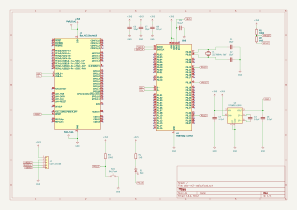

# otbr-m2-radio

nRF52840 (Raytac MDBT50Q-U1MV2) 802.15.4 radio on an M.2 Key B 2242 card,
intended as an OpenThread RCP for the Seeed ODYSSEY-X86J4105 cellular slot
(USB 2.0 only). KiCad 9.

- Schematic: [PDF](docs/otbr-m2-radio-schematic.pdf) · [SVG](docs/otbr-m2-radio-schematic.svg)

